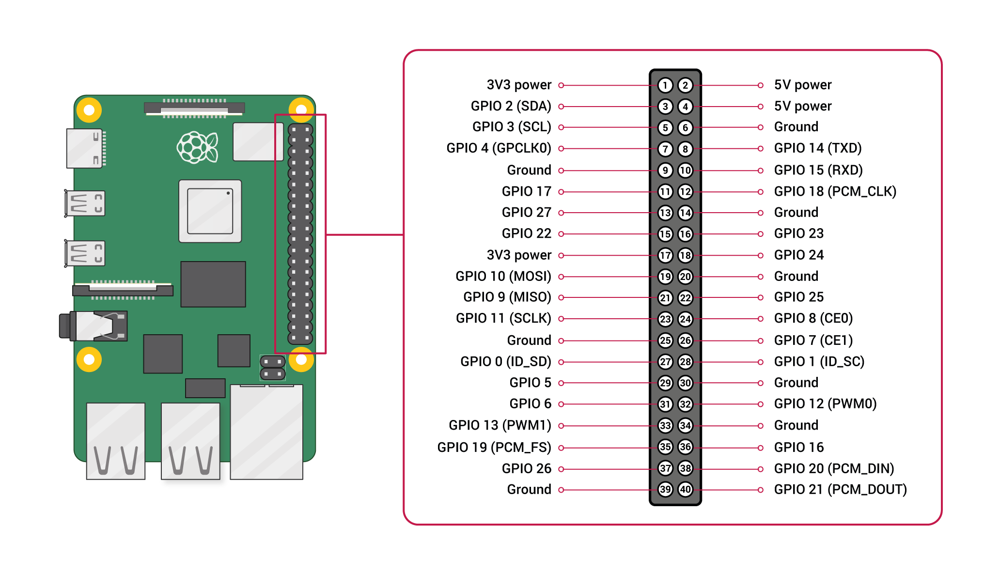
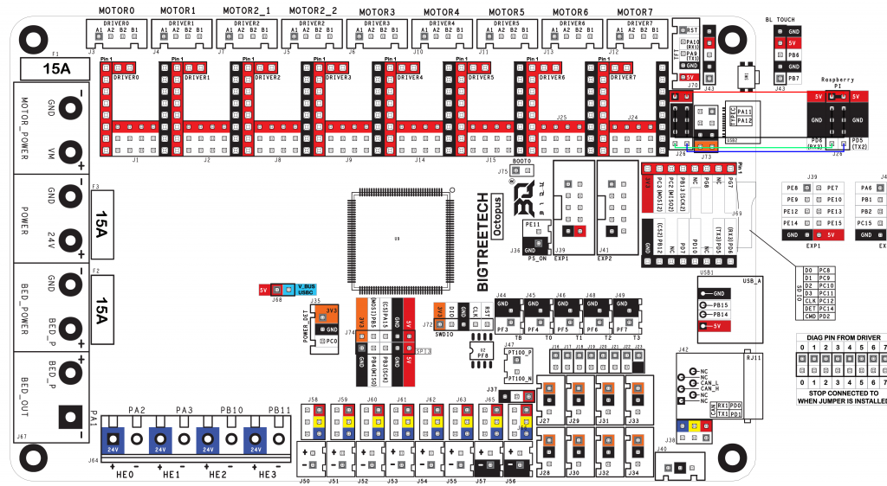

# The Doom³ (DoomCube)

> An XYZprinting da Vinci 1.0 with every bit of its stock logic ripped out and replaced with open-source hardware and firmware, plus a laser engraver in the lower half of the enclosure.


The Doom³ started life as an XYZprinting da Vinci 1.0. The proprietary controller is gone; the machine now runs [Klipper](https://www.klipper3d.org/) on a BigTreeTech Octopus v1.1, driven by a Raspberry Pi 4 running [Mainsail](https://docs.mainsail.xyz/). The bottom half of the enclosure houses a diode laser gantry with its own motion system, so one box does both FDM printing and laser engraving.

This repo holds the Klipper config, firmware, schematics, pinouts, and renders for the build, along with the firmware for the **Kube-Aid**, a custom power supply unit built to feed it.

---

## Contents

- [Features](#features)
- [Hardware overview](#hardware-overview)
- [Repository layout](#repository-layout)
- [Wiring and pinouts](#wiring-and-pinouts)
- [Klipper configuration](#klipper-configuration)
- [Kube-Aid power supply](#kube-aid-power-supply)
- [Getting started](#getting-started)
- [Known issues and notes](#known-issues-and-notes)
- [Author](#author)

---

## Features

- **Fully open-source control stack.** Klipper firmware on an STM32F446-based BTT Octopus v1.1, with a Raspberry Pi 4 as the Klipper host and Mainsail as the web UI.
- **Dual-purpose machine.** FDM printer up top, 500 mW laser engraver in the bottom half, each with its own gantry and stepper drivers.
- **Sensorless homing** on the printer's X and Y axes using TMC2209 StallGuard.
- **Input shaping** with an MPU-9250 accelerometer wired to the Pi's I²C bus.
- **Four thermistor channels:** bed, hotend, chamber, and the logic bay.
- **Active chamber control** with a chamber heater, circulator fans, and intake and exhaust fans.
- **Two displays:** a BTT Mini12864 on the Octopus EXP ports and a 7" 800×480 HDMI display on the front panel.
- **Lighting:** PWM-dimmed white chamber lights and an RGB LED strip run from the Pi's GPIO.
- **Extra I/O** on the front and logic panels, including spare laser-axis endstop inputs.


---

## Hardware overview

| Subsystem | Part |
|---|---|
| Base machine | XYZprinting da Vinci 1.0 (stock logic removed) |
| Controller | BigTreeTech Octopus v1.1 (STM32F446), Klipper MCU |
| Host | Raspberry Pi 4 Model B (Klipper + Mainsail, also acts as a secondary MCU for the accelerometer) |
| Stepper drivers | 6× TMC2209 (UART mode); driver slots 6 and 7 unpopulated |
| Motors | NEMA 14 throughout |
| Hotend / extruder | BIGQU H2v2S extruder, 0.4 mm nozzle, 1.75 mm filament |
| Thermistors | EPCOS 100K B57560G104F on all channels |
| Power supply | 24 V 500 W (inShare Plus), plus 12 V rails for fans, lights, and the RGB controller |
| Laser | 500 mW diode with PWM laser driver |
| Displays | BTT Mini12864 (EXP1/EXP2) and 7" 800×480 HDMI |
| Accelerometer | MPU-9250 over I²C (via the Pi) |
| RGB lighting | P9813-based controller (see [micropython-p9813](https://github.com/mcauser/micropython-p9813)) |

### Motion layout

| Octopus driver | Function |
|---|---|
| Motor 0 | Printer gantry X |
| Motor 1 | Printer gantry Y |
| Motor 2 (×2) | Laser gantry Y (left and right motors) |
| Motor 3 | Laser gantry X |
| Motor 4 | Extruder |
| Motor 5 | Bed Z |

Build volume as configured: **230 × 220 × 200 mm** (X × Y × Z).

### Heaters, fans, and outputs

| Octopus port | Function |
|---|---|
| HE0 | Heated bed |
| HE1 | Hotend |
| HE2 | Chamber heater |
| J50 | Logic bay cooler fan |
| J51 | White chamber LEDs (PWM) |
| J52 | Hotend parts cooling fan |
| J53 | Chamber heater fan |
| J54 | Chamber intake fan |
| J55 | Chamber exhaust fan |
| J56 | RGB controller power (always on) |
| J57 | Extruder cooler fan (always on) |

All fan and PWM power-select jumpers are set to 12 V.

### Thermistor channels

| Pin | Sensor |
|---|---|
| TB | Bed |
| T0 | Hotend (E0) |
| T1 | Chamber |
| T2 | Logic bay |

### Endstop and probe inputs

| Port | Use |
|---|---|
| J28 | Laser spare 1 |
| J30 | Laser spare 2 |
| J32 | Bed contacts / hotend probe |


---

## Repository layout

```
DoomCube/
├── BTT Octopus v1.1/
│   ├── printer.cfg                              # Main Klipper config
│   ├── generic-bigtreetech-octopus-v1.1.cfg     # Stock Octopus pin reference config
│   ├── Firmware/firmware.bin                    # Compiled Klipper MCU firmware
│   ├── BIGTREETECH Octopus - PIN.pdf            # Board pinout (BTT)
│   ├── octopus_pinout.png
│   ├── BTT Mini12864v1.png
├── Doom Cube System Schematic.dsn               # Whole-system schematic (TinyCAD)
├── Kube-Aid Schematic R1.dsn / .png             # Kube-Aid PSU schematic
├── KAOSv1/KAOSv1.ino                            # Kube-Aid OS v1.1 (Arduino Mega 2560)
├── 24vKAOSv1/24vKAOSv1.ino                      # 24 V variant (Arduino Nano + OLED)
├── GPIO-Pinout-Diagram-2.png                    # Raspberry Pi GPIO reference
├── btt_octopus_1.1_pins.png                     # Octopus pin reference
└── *.png                                        # Renders (DoomBox, JuiceBox, Front IO, Logic Panel)
```

The `.dsn` schematics open in [TinyCAD](https://www.tinycad.net).

---

## Wiring and pinouts

### Raspberry Pi 4 connections

| Pi pin | Connects to |
|---|---|
| Pin 2 (5 V) | RGB controller pin 3 (5 V) |
| Pin 4 (5 V) | Octopus J26 pin 2 (5 V) |
| Pin 6 (GND) | Octopus J26 pin 3 (GND) |
| Pin 7 (GPIO4) | RGB controller pin 1 (CIN / clock) |
| Pin 29 (GPIO5) | RGB controller pin 2 (DIN / data) |
| Pin 39 (GND) | RGB controller pin 4 (GND) |
| UART (Pi pins 9/10 → Octopus J26 pins 9/10) | Pi-to-Octopus serial link |
| HDMI | 7" front display |

The Klipper MCU connects over `/dev/ttyAMA0`, which is the Pi's hardware UART wired to the Octopus **USART2** port (J26: PD5 TX2 / PD6 RX2).



### Octopus reference



---

## Klipper configuration

`BTT Octopus v1.1/printer.cfg` defines:

- **Printer kinematics:** Cartesian, 150 mm/s max velocity, 1500 mm/s² max acceleration.
- **Homing:** sensorless X and Y via TMC2209 diag pins, then Z at a safe-home position of X=186, Y=197 with a 5 mm Z hop.
- **Extruder:** BIGQU H2v2S with a 7:1 gear ratio, PID tuned, 300 °C max.
- **Bed:** PID tuned, 130 °C max.
- **Chamber heater:** generic heater, PID tuned, 100 °C max with a relaxed `verify_heater` window.
- **Laser:** `pwm_tool` on PB5 with a 0.1 s cycle time. The laser X and Y axes are `manual_stepper` entries (`laser_x`, `laser_y`).
- **Lighting:** `led white_lights` on PE5 for the chamber lights.
- **Displays:** the BTT Mini12864 (`uc1701`) with its onboard beeper and 3-LED NeoPixel chain.
- **Accelerometer:** `mpu9250` over the Pi's I²C bus with `resonance_tester` and `input_shaper` (current tuning: MZV on both axes).
- **Mainsail:** pulled in with `[include mainsail.cfg]`.

---

## Kube-Aid power supply

The **Kube-Aid** is a custom 12 V 360 W PSU built for this project. It converts 110 V AC to 12 V DC and uses BEC regulators for 9 V, 5 V, and 3.3 V rails. An Arduino runs **K.A.O.S. (Kube-Aid Operating System)**, which sequences the power rails on boot and monitors the PSU's temperature.


### K.A.O.S. v1.1 (`KAOSv1/KAOSv1.ino`)

- **Board:** Arduino Mega 2560
- **Boot sequence:** shows a boot splash on a 16×2 LCD, then brings up the 5 V and 3.3 V rails one at a time via regulator-enable pins.
- **Run mode:** reads a DHT11 sensor and shows PSU temperature on the LCD, with serial output at 9600 baud.
- **Libraries:** `LiquidCrystal`, `SimpleDHT`

| Signal | Mega pin |
|---|---|
| DHT11 data | D11 |
| 5 V regulator enable | D13 |
| 3.3 V regulator enable | D12 |
| LCD RS / EN | D10 / D7 |
| LCD D4–D7 | D3 / D4 / D5 / D6 |


### 24 V variant (`24vKAOSv1/24vKAOSv1.ino`)

A sketch for the 24 V supply, targeting an Arduino Nano with a 128×64 SSD1306 OLED. It displays temperature (°C and °F) and humidity from a DHT11 and uses the onboard LED for status (a fast blink means a sensor read failed).

- **Libraries:** `U8g2`, `DHT sensor library`

---

## Getting started

> These steps assume you already have a Raspberry Pi running Klipper and Mainsail (for example via [KIAUH](https://github.com/dw-0/kiauh)).

1. **Build the MCU firmware.** Either flash the included `BTT Octopus v1.1/Firmware/firmware.bin`, or build your own with `make menuconfig` using:
   - Micro-controller: STM32
   - Processor model: STM32F446
   - Bootloader offset: 32 KiB bootloader
   - Clock reference: 12 MHz crystal
   - Communication interface: USART2 on PD6/PD5 (for the Pi UART link)
2. **Flash the Octopus** (SD card method: rename the binary to `firmware.bin`, copy it to a FAT-formatted SD card, insert it, and power-cycle the board).
3. **Enable the Pi's UART** and free it from the serial console so `/dev/ttyAMA0` is available to Klipper.
4. **Install the Linux-host MCU** (`klipper-mcu` service) so the `[mcu rpi]` section and the MPU-9250 work.
5. **Copy `printer.cfg`** into your Klipper config directory and make sure `mainsail.cfg` is present.
6. **Restart Klipper**, then tune: PID for each heater, `rotation_distance` values, `SHAPER_CALIBRATE`, and Z offset.
7. **Kube-Aid:** open the matching `.ino` in the Arduino IDE, install the libraries listed above, and upload.

---

## Known issues and notes

- `printer.cfg` was written against the 24 V PSU conversion. All heaters (bed, hotend cartridge, chamber heater) must be 24 V. Fans, chamber lights, and the RGB controller run from the Octopus's 12 V fan outputs.
- The laser axes are configured as `manual_stepper` axes, and their TMC2209 sections are currently commented out in `printer.cfg`.
- The Pi UART and Octopus USART2 link is a custom wiring arrangement, so double-check pins before powering up.

---

## Author

Designed and built by **Spenser Fenton** ([@rotarybean](https://github.com/rotarybean)). Also on [Thingiverse](https://www.thingiverse.com/rotarybean).

## License

- **Code and configuration** (`printer.cfg`, `KAOSv1.ino`, `24vKAOSv1.ino`): [MIT License](LICENSE)
- **Hardware designs and schematics:** [CERN-OHL-P v2](https://ohwr.org/cern_ohl_p_v2.txt)
- **Renders and documentation:** [CC BY 4.0](https://creativecommons.org/licenses/by/4.0/)

Third-party files (BigTreeTech pinouts and datasheets, Raspberry Pi GPIO diagram, and
the stock Octopus Klipper config) belong to their respective owners and are included
for reference only. Brand names and logos shown in renders are trademarks of their owners.
